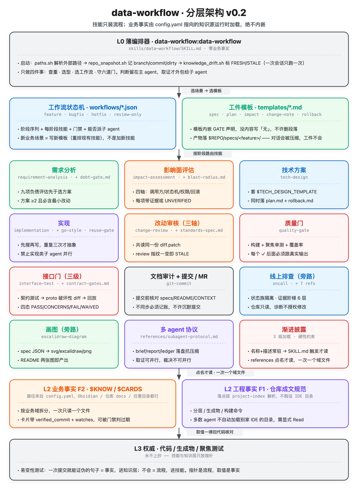
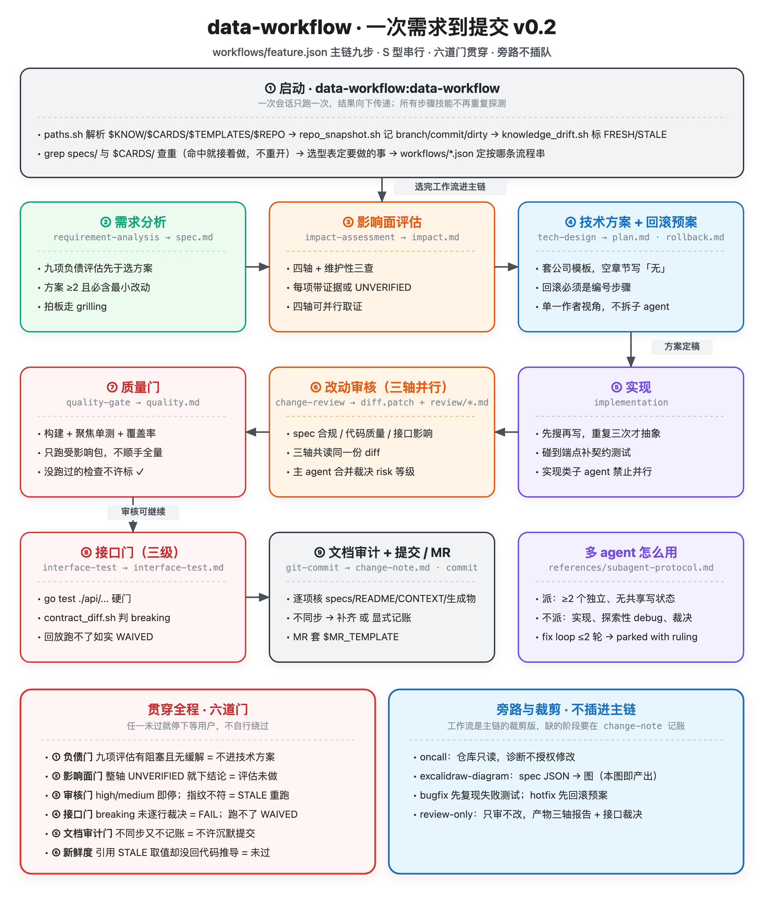

# data-workflow

data-service（Go / Kratos）从需求到提交的完整开发工作流，打包成一个**独立、可 git 管理、IDE 无关**的 skill 项目。

技能遵循 agentskills 开放约定（`SKILL.md` + `references/` + `scripts/`），同一份目录可被 Qoder / Claude Code / Cursor / Codex 等工具读取；安装只是往各工具的原生目录铺软链，不复制正文。业务事实**一个字节都不进技能**，运行时从配置指向的知识层按需加载。

## 分层架构



四层，加载方向只能向下，且**一次只读一个文件**：

| 层 | 位置 | 内容 | 加载方式 |
|---|---|---|---|
| L0 编排器 | `skills/data-workflow/` | 选型、顺序、门禁。零事实 | 入口触发 |
| L1 步骤技能 | `skills/<stage>/` | 每个阶段的流程；细节进 `references/` | 选型表路由 |
| L2 知识层 | `$KNOW/**`、`$TEMPLATES/**`（由 `config.yaml` 指向，Obsidian / 仓库内 `docs/` / 任意目录都行）；仓库成文规范（落点按 `references/project-index.md` 解析：`.cursor/rules/` → `.qoder/rules/` → `AGENTS.md` → `CLAUDE.md`） | 业务事实 F2、工程事实 F1 | 点名才读，一次一个域文件 |
| L3 权威 | 代码、生成物、聚焦测试 | 永不上抄 | 取值一律回这里核对 |

仓库内 `docs/`、`docs/support/` 是**降级区**：已被证实在 MQTT 推送链路与 Episode 终态上说谎，只可当搜索线索，不可当结论。

## 一次需求到提交的流程



主链九步（`workflows/feature.json`），S 型串行，不并行跳步；**六道门**贯穿全程，任一未过就停下等用户：

1. **负债门** —— 九项前置评估（维护性 / 可运营性 / 可信性）有阻塞且无缓解，不进技术方案。
2. **影响面门** —— 四轴（调用方 / 状态机 / 租户权限 / 回滚）任一项既无证据也没标 `UNVERIFIED`，视为评估未做。
3. **改动审核门** —— high / medium 即停；review 指纹（base/head sha + 文件数 + 行数）与工作树不符 = 结论 STALE，必须重跑。
4. **接口门** —— 契约测试失败、或 `contract_diff.sh` 报 breaking 而没逐行裁决 = FAIL；场景回放跑不了只能如实 WAIVED，不许谎报 PASS。
5. **文档审计门** —— 提交前对照 `git diff` 核 `specs/<feature>/`、README、CONTEXT、生成物；不同步就补齐，或在 change-note 显式记「接受的文档风险」，不许沉默提交。
6. **新鲜度门** —— `knowledge_drift.sh` 标 STALE 的文档只当线索，引用了它的取值却没回代码推导，算未过。

两条旁路不进主线：`oncall`（线上排查，仓库只读，诊断不授权修改）与 `excalidraw-diagram`（画图，上面两张图就是它产出的）。

## 工件、工作流与多 agent

**工件是流程的记忆**：对话会被上下文压缩吃掉，落盘的文件不会。每步产物落 `$REPO/specs/<feature>/`（spec / impact / plan / rollback / diff.patch / review/×3 / quality / interface-test / change-note / agents/），模板在 `templates/` 且内嵌 GATE 声明。

**工作流是扩展点**：`workflows/*.json` 是确定性状态机（阶段序列 + 每阶段技能 + 门禁 + 能否派子 agent）。新业务场景写新模板重排现有技能，**不是加新技能**——`feature` / `bugfix` / `hotfix` / `review-only` 四个模板互为裁剪版。

**多 agent 有判据**：`references/subagent-protocol.md`。派：≥2 个彼此独立、无共享写状态、互不需要对方上下文的问题（审核三轴、影响面四轴取证）。不派：实现类（共享工作树会互相覆盖）、探索性 debug、相关联失败、事故期、**任何裁决**。取证可并行，裁决不可并行；brief 里不塞业务事实（塞下去等于把主 agent 的偏见传成锚点）；fix loop 上限 2 轮，第 3 轮不收敛就 `parked with ruling` 记账交人。

## 设计原则

**技能只装流程，业务事实运行时读取。**

判断一句话该放哪，用易变性测试：*明天一个代码 commit 能否让这句话变成假的，而不需要任何人编辑它所在的文件？*

- 能 → **事实**，放知识层，带 `verified_commit` + `watches`，可被新鲜度门禁判过期
- 不能 → **流程**，放技能

两条推论：

- **指针是流程，取值是事实。**「EpisodeStatus 定义在 `internal/biz/status.go`」永远成立；「Episode 终态是 90/91」一次提交就假。
- **绝不存「假了也没声音」的事实。** 优先选过期后会响亮地漏（agent 去 grep，发现比文档列的更多）的形式，而不是安静地骗（agent 信文档，从不 grep）。

## 项目结构

```
data-workflow/
├── .qoder-plugin/plugin.json        Qoder 插件清单
├── .claude-plugin/                  Claude Code 插件清单 + marketplace
├── AGENTS.md                        薄指路牌（Codex / 通用 agent 读这个）
├── config.example.yaml              知识源与仓库路径的键位说明（进 git）
├── config.yaml                      本机实际值（gitignore，每人不同）
├── README.md
├── assets/                          架构图、流程图（.svg 源 + .png 位图 + .excalidraw 可编辑）
├── evals/evals.json                 12 条评测，逐条钉住已修好的缺陷
├── templates/                       5 个工件模板，内嵌 GATE 声明
│   └── spec · plan · impact · change-note · rollback
├── workflows/                       4 个状态机：feature · bugfix · hotfix · review-only
├── scripts/
│   ├── resolve.sh                   解析单个配置键（env > config.yaml > ~/.config）
│   ├── paths.sh                     一次性 eval 出 $KNOW $CARDS $TEMPLATES $REPO 等
│   ├── install.sh                   往已存在的 .qoder/.claude/.cursor/.codex/.agents 铺软链
│   ├── repo_snapshot.sh             记录被测仓库 branch / commit / dirty
│   ├── knowledge_drift.sh           知识新鲜度门禁：FRESH / STALE / SKIP / DEGRADED
│   ├── contract_diff.sh             proto 契约破坏性 diff（七类 breaking）
│   ├── proto_contract.py            把 proto 归一成可 diff 的事实行
│   └── svg_to_png.sh                headless Chrome 补 PNG（generator 依赖的 rsvg-convert 本机没装）
└── skills/
    ├── data-workflow/               L0 编排器
    │   └── references/              project-index · feature-archive ·
    │                                subagent-protocol · artifact-tree
    ├── requirement-analysis/        + debt-gate.md（九项前置评估）
    ├── impact-assessment/           + blast-radius.md（四轴取证与回滚模板）
    ├── tech-design/
    ├── implementation/              + go-style.md · reuse-gate.md
    ├── change-review/               + standards-spec.md
    ├── quality-gate/
    ├── interface-test/              + contract-gates.md（三级门与四态裁决）
    ├── git-commit/
    ├── oncall/                      + 7 份 references（routing / state-protocol / trace /
    │                                evidence / answer / capture / knowledge-sources）
    └── excalidraw-diagram/          + excalidraw-spec.md + scripts/diagram_generator.js
```

渐进披露三级加载：名称+描述常驻 → SKILL.md 触发时才读 → references 点名才读。

## 技能清单

| 技能 | 作用 | 不用于 |
|---|---|---|
| `data-workflow:data-workflow` | 入口：环境探测 → 查重 → 选型 → 选工作流 → 串联 → 六道门 | 直接干活，它只路由 |
| `data-workflow:requirement-analysis` | 需求拆解、事实清单 + 决定表、九项负债评估先于选方案；拍板走 `grilling` | 已明确的需求 |
| `data-workflow:impact-assessment` | 影响面四轴（调用方 / 状态机 / 权限 / 回滚）+ 维护性三查，每项带证据或 `UNVERIFIED` | 已经拍板只等写代码 |
| `data-workflow:tech-design` | 套公司模板写技术方案，同时落 `plan.md` + `rollback.md` | 小改动的随手设计 |
| `data-workflow:implementation` | 编码实现 + Go 规范（R01–R18）+ 复用门禁 | 审核已有改动 |
| `data-workflow:change-review` | 改动风险审核；大 diff 拆三轴并行子 agent 共读同一份 `diff.patch`，带 review 指纹 | 需求分析、全仓审计 |
| `data-workflow:quality-gate` | 用命令真实输出证明可提交：构建 / 聚焦单测 / 覆盖率 / 生成物 | 接口裁决（归 interface-test） |
| `data-workflow:interface-test` | 契约三级门（进程内契约测试 → proto 破坏性 diff → 场景回放）+ 四态裁决 | 跑单测覆盖率（归 quality-gate） |
| `data-workflow:git-commit` | 分支名、Conventional Commits、**提交前文档审计门**、MR 描述 | 普通 git 查询 |
| `data-workflow:oncall` | 线上排查：状态族隔离、证据阶梯、降级区 | 纯代码风格、纯 git 操作 |
| `data-workflow:excalidraw-diagram` | spec JSON → `.excalidraw` + `.svg` + `.png` | 手绘草图、UML 严格语法 |

技能之间只用**命名空间名**互相调用，不写绝对路径 —— 换机器、换目录都不会断。

## 脚本

| 脚本 | 作用 |
|---|---|
| `scripts/resolve.sh <key>` | 解析单个配置键，值走 stdout、来源走 stderr；未配置返回空而不是猜 |
| `scripts/paths.sh` | 一次 `eval` 出 `$KNOW $CARDS $TEMPLATES $REPO $TECH_DESIGN_TEMPLATE $MR_TEMPLATE $PERSONAL_AGENTS_MD` |
| `scripts/install.sh` | 往**已存在**的工具目录铺软链（`--global` 用 `$HOME`，`--unlink` 只删指向本仓的链），幂等 |
| `scripts/repo_snapshot.sh` | 记录被测仓库的 branch / commit / dirty 状态 |
| `scripts/knowledge_drift.sh` | 读 frontmatter 的 `verified_commit` 与 `watches`，比对被测仓库 HEAD，输出 `FRESH` / `STALE` / `SKIP` |
| `scripts/contract_diff.sh <base>` | 以 merge-base 的 proto 为基线、工作区为对比侧，输出七类 breaking（删 rpc / 端点变更 / 删字段 / 字段号复用 / 删枚举 / 枚举号复用 / 删文件）；恒 exit 0，裁决归技能 |
| `scripts/proto_contract.py` | 把 proto 归一成 `RPC/REQ/RES/FIELD/ENUMVAL/FILE` 事实行，供 contract_diff 比对 |
| `scripts/svg_to_png.sh` | headless Chrome 把 SVG 转 PNG（2x），补上 generator 缺失的那一步 |

门禁**只标注、不阻塞**：恒 exit 0，exit 2 仅表示文档无法解析。缺 frontmatter 按 STALE 处理 —— 让未纳管的文档自我暴露，而不是靠制度。

被测仓库优先级：`$DS_REPO` > `config.yaml` 的 `repo` > 当前目录所在仓库。知识源优先级：`DATA_WORKFLOW_<KEY>` 环境变量 > `./config.yaml` > `<插件根>/config.yaml` > `~/.config/data-workflow/config.yaml` > 空（知识源为空时 drift 打印 `DEGRADED` 并回退 `<repo>/docs`）。

## 知识落点

| 落点 | 归属 |
|---|---|
| `$KNOW/<域>/` | 已稳定的领域知识，按业务域拆分 |
| `$KNOW/排查卡片/` | oncall 调查结论，`symptoms:` 字段就是 grep 检索面 |
| `$TEMPLATES/` | 公司模板（研发技术方案、MR） |
| `$REPO/specs/<feature>/` | 工件树：每步产物落盘，是流程的记忆（见 `references/artifact-tree.md`） |
| 该 IDE 的临时目录（`.cursor/plans/`、`.qoder/plans/` 等） | 决策前的工作记忆，临时，不升级为工件 |

每张卡带 `verified_commit` 与 `watches`，`knowledge_drift.sh` 读同一组字段，卡片免费获得可门禁性。

## 知识源配置

技能正文里没有任何绝对路径。所有外部落点通过 `config.yaml` 解析：

```bash
cp config.example.yaml config.yaml   # config.yaml 已 gitignore，每人一份
$EDITOR config.yaml
bash scripts/paths.sh                # 验证解析结果
```

| 键 | 含义 | 留空时的行为 |
|---|---|---|
| `knowledge_root` | 知识层根（Obsidian vault 子目录、仓库内 `docs/`、任意目录都行） | drift 打印 `DEGRADED`，回退 `<repo>/docs` |
| `cards_dir` | 排查卡片目录 | 回退 `<knowledge_root>/排查卡片`，不存在则报 MISSING |
| `templates_root` | 公司模板根 | 需要模板时问用户，不自创章节 |
| `repo` | 被测代码仓库 | 回退当前目录所在 git 仓库 |
| `tech_design_template` / `mr_template` | 两个具体模板文件 | 问用户；MR 用技能内兜底模板并注明 |
| `personal_agents_md` | 个人工程规范文件 | 只用仓库内规范与本仓 R 系列条目 |

也可以完全不建 `config.yaml`，改用环境变量：`DATA_WORKFLOW_KNOWLEDGE_ROOT=/path/to/knowledge`。

## 安装与更新

```bash
git clone <本仓库> ~/skills/data-workflow
cd <你的项目>                       # 或加 --global 铺到 $HOME
bash ~/skills/data-workflow/scripts/install.sh
```

`install.sh` 只对**已存在**的 `.qoder` `.claude` `.cursor` `.codex` `.agents` 目录动手，在其中建 `skills/<name>` 软链指向本仓库，绝不创建你没有的工具目录：

```bash
bash scripts/install.sh             # 铺到当前项目
bash scripts/install.sh --global    # 铺到 $HOME（用户级）
bash scripts/install.sh --unlink    # 只删指向本仓库的软链
```

软链而非复制 —— 改完即生效，同一 inode，结构上不可能分叉。跑两次结果一致；`--unlink` 后目录回到干净状态。

Qoder 也可以走插件通道（会**复制**进缓存，改完需要更新）：

```bash
qoder plugins install ~/skills/data-workflow --scope user
ln -sfn ~/skills/data-workflow ~/.qoder/plugins/cache/local/data-workflow/0.2.0   # 想要改完即生效
```

## 验证

`evals/evals.json` 12 条评测，每条带 `pass` / `fail` 证据条件，逐条对应历史上真实踩过的坑或这次补上的能力缺口：

1. MQTT 推送链路必须点名 `MQTTTopicJobDispatchNotification`，答成「只能轮询」即失败
2. 裸 `status=20` 必须先问是哪一族，或按族给限定名
3. episode 终态必须报出 92/93 并用 `IsForsaken()`，停在 90/91 即失败
4. 审核不得引用虚构 API（`TimeToUnixString`、`TenantScope(tenantID)`、`repo_helpers`、`scopes.go`）；大 diff 必须三轴并行且带 review 指纹
5. 卡片回写端到端：写卡 → 更新索引 → 按症状词 grep 命中
6. 一句话状态问题的 token 预算 ≤ 200 行
7. `make api-one` 必须带 `PROTO=`，裸跑即失败；且不假设某个 IDE 的规则目录存在
8. tech-design 必须打开 `$TECH_DESIGN_TEMPLATE` 指向的真实模板文件
9. 影响面四轴每项带证据或 `UNVERIFIED`；整轴空白却下「影响可控」即失败
10. 接口门三级齐跑、四态裁决；breaking 未逐行裁决却判 PASS、或跑不了回放谎报 PASS 即失败
11. 提交前必须过文档审计门；跳过审计直接 commit、或不同步又不记账即失败
12. `install.sh` 幂等（连跑两次结果一致）、`--unlink` 只删本仓软链；`resolve.sh` 四级优先级；未配置知识源打印 `DEGRADED` 而非猜路径

## 图怎么重新生成

```bash
cd ~/skills/data-workflow
node skills/excalidraw-diagram/scripts/diagram_generator.js .staging/architecture.spec.json assets architecture
node skills/excalidraw-diagram/scripts/diagram_generator.js .staging/flow.spec.json        assets flow
bash scripts/svg_to_png.sh assets/architecture.svg assets/architecture.png 2
bash scripts/svg_to_png.sh assets/flow.svg         assets/flow.png         2
```

`.staging/` 里的 spec JSON 是两张图的源（进 git，换机器也能重画）；改卡片内容就改 spec，重跑四条命令即可。`.excalidraw` 文件可直接拖进 excalidraw.com 继续手改。PNG 一并进 git，不跑脚本也能直接看图。
