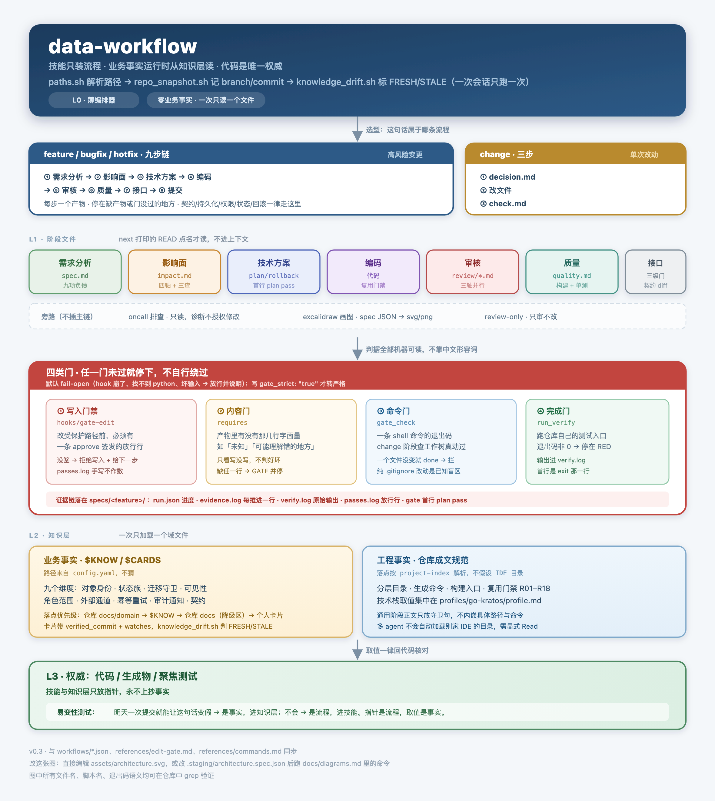
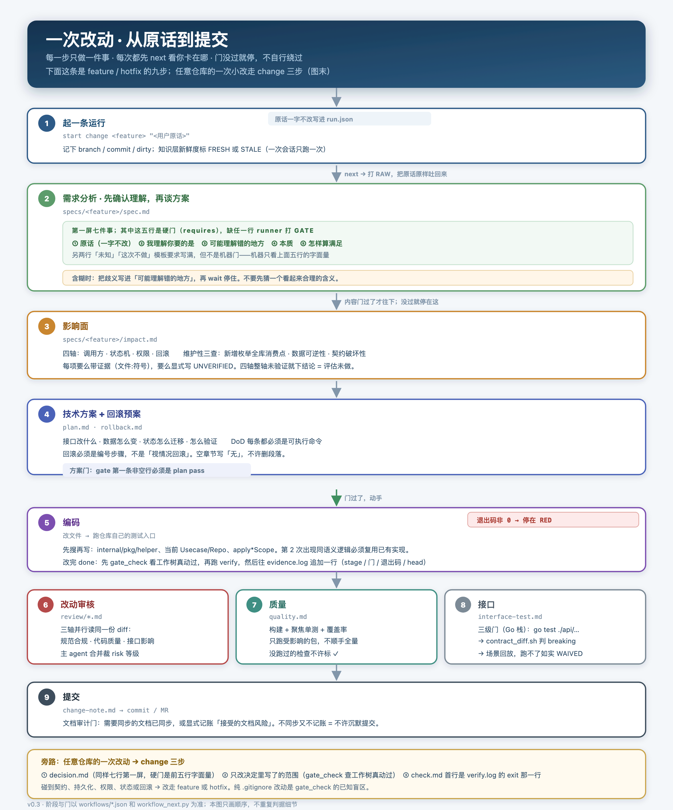

# data-workflow

## 用起来是什么样的

装上之后，你基本不用敲命令。**新会话 AI 自动读这套东西，自己推进**：

- 你说"给订单加个过滤字段" → AI 自己开工作流、写决策、改代码、跑测试、过门禁
- 中途换话题、关窗口、第二天回来 → AI 看到未完成的运行，继续从上次停的地方接着做
- 你想精确控制（恢复中断、调一步的细节）→ 手动跑命令。命令是**你可选的遥控器**，不是必须学的东西

强制门禁只在 Cursor + `--with-hooks` 模式下生效：改 `api/`、proto、`status.go` 这些路径前必须有放行记录，没有就拒绝写入。其他环境（Qoder、Claude、Codex）里只有技能副本，没有硬拦截——AI 自觉跑流程，不拦裸改。

这套技能做三件事：

1. **写入门禁**：改受保护路径前，要有一条「有人同意」的放行记录；这条记录只能由 `approve` 签发，而 `approve` 要求先有过一次拍板对话。
2. **完成证据**：说"做完了"必须有退出码。编码阶段先过 `gate_check`（工作树真动过），再跑仓库自己的测试入口，然后往 `evidence.log` 追加一行，含 `head`。
3. **业务口径**：一个词、一个字段、一个状态在这个业务里是什么意思 —— 看哪九个维度、去哪读、落在哪。事实不写进技能，运行时从知识层读，取值回代码。

高风险变更用 `feature` 九步链（data-service Go / Kratos **实例**，取值在 `profiles/go-kratos/`）；任意仓库的一次改动或定架构默认走 `change` 三步。安装默认把技能放进 `$HOME`，项目里只留 4 个 `/` 命令——技能副本自包含，不软链回本仓库。要 Cursor 里的强制写入门禁，显式 `--project --with-hooks`。

## AI 自动推进 vs 手动命令

AI 自觉跑命令是**默认行为**。会话钩子会注入未完成运行的 NOTICE，AI 读到之后自己决定要不要 `next`。你几乎不用管它。

手动命令只在三种情况用：

| 什么时候 | 做什么 |
|---|---|
| 旧会话没注入 hook（Cursor 只给新会话注入） | 手动跑 `next` 看当前状态 |
| 你想恢复一条中断很久的运行 | `next` 打印 NEED/DO/OPEN 后，你自己决定要不要继续 |
| 你在调试这套技能本身 | 直接跑 `python3 .../workflow_next.py next` 看原始输出 |

命令清单在 `references/commands.md` 里，不需要提前记住。

## 你在什么状态，读什么

- 第一次安装 → [`docs/install.md`](docs/install.md)
- 会话里有 NOTICE → 那是另一条未完成运行，不代替当前这句话。要继续它再跑 `next`
- 不知道下一步做什么 → `next`。它只打一件事：`NEED`（缺产物）/ `GATE`（门没过）/ `OPEN`（待拍板）/ `DO`（动手）/ `WAIT`（等一句回复）/ `DONE` / `LAST`
- 要选工作流，或看卡在哪一道门 → [`skills/data-workflow/references/workflows.md`](skills/data-workflow/references/workflows.md)
- 命令表 → [`references/commands.md`](skills/data-workflow/references/commands.md)。Agent 输入框输入 `/`，选 `dw-next`、`dw-done`、`dw-wait`、`dw-start`
- 要知道一个词在业务里指什么 → `business-model.md`（看什么）× `routing.md`（去哪读）。路径空就问。键在 [`config.example.yaml`](config.example.yaml)
- 竞品对照、设计笔记、研究记录（维护者用）→ [`docs/dev/`](docs/dev/)
- 要改技能或新增阶段 → 下面的项目结构。阶段正文在 `stages/`，选型在 `SKILL.md`
- 要重画两张图 → [`docs/diagrams.md`](docs/diagrams.md)

## 一条改动实际怎么走

```bash
start change <feature> "<用户原话>"   # 记账 + 原话一字不改写进 run.json（next 会打 RAW）
next                                  # → READ <阶段文件> + NEED <产物>
# 写 decision.md 第一屏：原话（一字不改）/ 我理解你要的是 / 可能理解错的地方 /
#                        本质 / 怎样算满足 / 未知 / 这次不做
next                                  # → GATE 缺哪行（内容门），补完才往下
#   含糊时把歧义写进「可能理解错的地方」再 wait，不要先猜
# 改代码
done                                  # → GATE(工作树没动就停) → verify → evidence.log
# 写 check.md（首行是 verify.log 的 exit 那一行）
done                                  # → DONE
```

要放行受保护路径：`wait` → 对方回那句 → `answer` → `approve <feature> design|waiver <前缀>`。**不要手写 `specs/passes.log`**：`gate_strict` 下没有 `approved` 标记的行不作数。

## 知识层

业务梳理不另建技能。

| 问题 | 答案在哪 |
|---|---|
| 看什么维度 | [`references/business-model.md`](skills/data-workflow/references/business-model.md) 九个维度：对象与身份 / 状态族 / 迁移与守卫 / 读侧可见性 / 角色与数据范围 / 外部通道 / 幂等与重试 / 审计与通知 / 契约。每维写清「问什么 / 去哪读 / 证据形式 / 典型错答」 |
| 去哪找 | [`stages/oncall/references/routing.md`](skills/data-workflow/stages/oncall/references/routing.md)：先 grep `$CARDS/`（空目录会跳过）→ 读一个域文件 → 取值回代码 |
| 落在哪（从高到低） | ① 仓库内 `docs/domain/<域>.md`（`$DOMAIN_DOCS`，按 `templates/domain-doc-template.md` 写，随代码提交，`knowledge_drift.sh` 判新鲜度）② `$KNOW`（补充源，引用时标「未核对」）③ 仓库 `docs/`（降级区，只当线索）④ 个人卡片 `$CARDS/`（一次事件的现象） |

卡片带 `verified_commit`、`watches`、`verified_at`；`knowledge_drift.sh` 标 `FRESH` / `STALE`，不停工；`status: superseded` 的卡跳过。**代码证明的是现在会怎么做，不是「业务要求永远如此」。**

这句话决定了知识层怎么回写：`quality-gate` 的 G7 在每次改动后比对 `watches`，命中就刷新指针类条目（`文件:符号`、`verified_commit`），**但业务口径一栏只标冲突、不改结论**——否则等于让代码给自己发合规证明。冲突交给人拍板。

没有出处的词进「待确认」，用 `wait` 停，不编一个看起来合理的含义。命中卡片后对照它的 `watches`：代码仍符合才当现行规则；已不符合就标冲突，旧卡标 `superseded`。

动手前读 [`references/scope.md`](skills/data-workflow/references/scope.md)。先写用户真正要解决的问题和怎样算满足，再决定改多宽。L1 走 `change`；契约、持久化、权限、状态、回滚即使改动很小也升到 `feature` 或 `hotfix`；与这次无关的债不进这次 diff。

## 分层



加载方向只能向下，一次只读一个文件。

| 层 | 位置 | 内容 | 加载方式 |
|---|---|---|---|
| L0 编排 | `skills/data-workflow/SKILL.md` | 选型。零事实 | 入口触发 |
| L1 阶段 | `skills/data-workflow/stages/` | 每个阶段的步骤 | `next` 打印的 `READ` 点名才读 |
| L2 知识 | `docs/domain/**`、`$KNOW/**`、`$TEMPLATES/**` | 业务口径 | 一次一个域文件 |
| L3 权威 | 代码、生成物、聚焦测试 | 取值 | 回这里核对 |

仓库内 `docs/`、`docs/support/` 是降级区：只可当搜索线索。data-service 实例里 MQTT 推送链路和 Episode 终态以代码为准。

## 主链



`workflows/feature.json` 串行（data-service Go 栈实例）。**机器阶段 7 个**：下表把 stage 6「质量与接口门」拆成两行讲，因为它有四道判据但只产一个 `quality.md`。第 1 行是启动动作，不是独立阶段。

| 步 | 产出 | 门 |
|---|---|---|
| 启动 | branch、commit、知识新鲜度 | 查重与新鲜度（一次性，不进 stage 序列） |
| 1 需求与负债评估 | `specs/<feature>/spec.md` | `requires` 五行字面量 + 九项负债 |
| 2 影响面评估 | `specs/<feature>/impact.md` | 四轴 + 维护性三查 |
| 3 技术方案 | `plan.md`、`rollback.md` | 方案门（`gate` 首行 `plan pass`） |
| 4 编码实现 | 代码（Go 栈另可补 `*_contract_test.go`） | `gate_check` + 仓库自己的 `verify` 退出码 |
| 5 改动审核 | `specs/<feature>/review/*.md` | 审核指纹与工作树 |
| 6 质量与接口门 | `quality.md` | 构建 / 单测证据 ＋ 接口三级门：`go test ./api/...` → `contract_diff.sh` → 场景回放或如实 WAIVED ＋ G7 知识反哺（碰到的域自动刷新指针，口径冲突只标不改） |
| 7 文档审计与提交 | `change-note.md`、commit、MR | 文档审计 |

`bugfix` / `hotfix` 的第一步是排查。`oncall` 和画图不插入这条链。任意仓库的一次改动或定架构用 `workflows/change.json`，三步：`decision.md` → 改文件 → `check.md`。

工件落点：[`references/artifact-tree.md`](skills/data-workflow/references/artifact-tree.md)。写入放行：[`references/edit-gate.md`](skills/data-workflow/references/edit-gate.md)。什么时候派子代理：[`references/subagent-protocol.md`](skills/data-workflow/references/subagent-protocol.md)。

## 门与证据

门按**判据由谁执行**分四类，判据都是机器可读的，不是中文形容词。这是门的唯一分类：

| 门 | 谁判 | 判什么 | 没过时 |
|---|---|---|---|
| 写入门禁 | `hooks/gate-edit` | 这次调用写不写受保护路径、有没有覆盖它的 `approved` 放行行 | 拒绝写入，理由里给下一步命令 |
| 内容门 | `workflow_next.py` 的 `requires` | 产物里有没有那几行字面量（如「未知」） | `next`/`done` 打 `GATE` 并停 |
| 命令门 | `workflow_next.py` 的 `gate_check` | 一条 shell 命令的退出码（`change` 的编码阶段查工作树真动过） | 打 `GATE` + 命令输出尾部 |
| 完成门 | `workflow_next.py` 的 `run_verify` | 仓库自己声明的测试入口的退出码 | 停在 `RED`，输出进 `verify.log` |

`workflows.md` 另有一张按**流程步位**分的表（负债 / 影响面 / 改动审核 / 接口 / 文档审计 / 新鲜度）。那不是第二套门，是上表四类在不同步位的**实例**：每一行都落到四类里的一类去判。要改判据改本表，要改顺序改那张。

**`workflows/*.json` 里的 `self_check` 不是门。** 它是一段给 Agent 读的自评提示（如「四轴都填了吗」），没有裁判：机器只判 `requires` 字面量在不在和命令退出码。它以前叫 `gate`，容易被读成上面四类中的一员，所以改名。待确认断言记在 [`docs/dev/claim-register.md`](docs/dev/claim-register.md)。

**`close_if` 也不是第五类门。** 它是上面「内容门 + 命令门」在**反方向**上的同一个判据：`requires` 问「这一步做完了吗」，`close_if` 问「这一步还需要做吗」。判据本身没变——产物里的字面量 + 一条命令的退出码，由 `workflow_next.py` 判——只是结论从「继续」变成「关掉」。所以 `close` 只由显式子命令触发，不在 `next` 里自动评（`next` 必须只读）。**字面量单独不足以关单**：写「已修复」谁都会写，`fingerprint` 才能提供外部锚点。

`fingerprint` 的**极性是反的**，这是全仓唯一一处：它是一条**复现命令**，`exit 0` 表示「bug 仍然复现」，所以 `exit 0` **不许关单**；`exit 非 0` 才说明 bug 不在了、可以关。填错方向会静默关掉活着的 bug，所以 `bugfix.json` 的出厂值是一条**恒 exit 0** 的占位命令（关不了单，并叫你去改）。没配 `close_if` 的阶段打 `NO_EXIT`。

`specs/<feature>/` 里的证据链：

```
run.json      停在第几步（进度，不存理由）；terminal 的 status 有 done / closed / abandoned 三种
run.json.outcome  仅 closed 有：为什么关（fixed / wontfix / accepted …）
evidence.log  每次推进一行：stage / 门 / 退出码 / head / 时间 / by=runner（只由 runner 写）
verify.log    测试入口的原始输出（第一行是 exit）
passes.log    放行记录（只由 approve 写，行尾带 approved）
gate          方案门：第一条非空行是 plan pass
*.md          人读的产物（decision / spec / impact / plan / check / change-note …）
```

`next` 会顺带打出两行派生信息：`DECIDED <最近一条 已拍板>` 和 `NOTE 工作树已变（记录 X → 现在 Y）`。都不阻塞。

**门禁的失效策略**：默认 fail-open（hook 崩了、找不到 python、坏输入 → 放行并说明）；写 `gate_strict: "true"` 才转严格。理由是门禁不该因为自己的故障拦住正确操作，兜底仍然是提交前看 diff。

## 设计原则

判断一句话该放哪：明天一次代码提交能否让这句话变成假的，而不必改它所在的文件？

- 能 → 事实，放知识层，带 `verified_commit` 和 `watches`
- 不能 → 流程，放技能

指针是流程，取值是事实。「EpisodeStatus 定义在 `internal/biz/status.go`」仍成立；「终态是 90/91」一次提交就假。过期后要漏得响：代理去代码里找，而不是信一份不再更新的清单。

同理：技术栈取值（分层目录、`api/**`、`make api-one`、九项负债）不写在通用阶段正文里，集中在 [`profiles/go-kratos/profile.md`](skills/data-workflow/profiles/go-kratos/profile.md)，其他地方只放守卫句。

## 项目结构

```
data-workflow/
├── AGENTS.md                     薄指路牌
├── config.example.yaml           配置键。副本里的 config.yaml 不进本仓库
├── docs/                         安装、脚本、竞品对照、可执行工作流、重画图
├── evals/evals.json              机器可判的回归用例（由 verify.sh 执行）
├── scripts/
│   ├── install.sh                分发（默认 / --project / --with-hooks / --unlink）
│   └── verify.sh                 本仓库声明的测试入口（自己探测 python）
└── skills/data-workflow/         唯一安装的技能
    ├── SKILL.md                  选型。阶段→文件不在正文里维护
    ├── commands/                 复制到目标仓库 .cursor/commands/ 的 / 命令
    ├── workflows/                feature · bugfix · hotfix · review-only · change
    ├── profiles/                 go-kratos：技术栈实例取值
    ├── references/               命令、门、工件、业务维度、子代理协议。点名再读
    ├── hooks/                    gate-edit（壳 + gate_edit.py）· session-start
    ├── scripts/                  workflow_next · knowledge_drift · find_python · …
    └── stages/                   阶段文件，不单独安装
```

常驻的只有技能的名称和描述（179 字）。触发后读 `SKILL.md`。之后读哪个阶段文件**只由 `next` 打印的 `READ` 决定**；不经工作流的只有四个入口：业务梳理、排查、提交、画图。

## 安装与验证

先把本仓库放到本机某处，下面用 `<data-workflow>` 表示它的路径。然后在**目标仓库根**执行。

macOS / Linux：

```bash
cd <目标仓库根>
bash <data-workflow>/scripts/install.sh                       # 默认：技能进 $HOME，项目只加 4 个命令
bash <data-workflow>/scripts/install.sh --project --with-hooks  # 副本进仓库 + Cursor 门禁
bash <data-workflow>/scripts/install.sh --unlink              # 撤掉本脚本写过的东西
```

Windows（PowerShell 或 cmd）。**不要直接敲 `bash`**：PATH 上的 `bash` 常常是还没安装发行版的 WSL，跑起来只会弹出 Linux 安装提示，不会执行本脚本。用下面这个入口，它会调用 Git for Windows 自带的 Git Bash（请先安装 [Git for Windows](https://git-scm.com/download/win)）：

```bat
cd <目标仓库根>
<data-workflow>\scripts\install.cmd                       # 默认：技能进用户主目录，项目只加 4 个命令
<data-workflow>\scripts\install.cmd --project --with-hooks  # 副本进仓库 + Cursor 门禁
<data-workflow>\scripts\install.cmd --unlink              # 撤掉本脚本写过的东西
```

本仓库如果就在桌面，把 `<data-workflow>` 换成实际路径即可，例如 `C:\Users\你\Desktop\data-workflow\scripts\install.cmd`。

技能能力在三种模式里都是完整的，差别只在门禁。为什么不能「副本被忽略、却提交 hooks.json」，以及各种落点往仓库里写什么，在 [`docs/install.md`](docs/install.md)。

验证本仓库：

```bash
bash scripts/verify.sh      # 60 条回归，末行打印 OK；不需要预先配 python
```

脚本清单在 [`docs/scripts.md`](docs/scripts.md)。

**用例分两处，别混：**

| 位置 | 判什么 | 谁执行 |
|---|---|---|
| [`evals/evals.json`](evals/evals.json) | 行为对不对（安装幂等、门禁拒绝、退出码、文件落点） | `bash scripts/verify.sh`，进 CI |
| [`docs/review-cases.md`](docs/review-cases.md) | 答得对不对（是否点名真实文件、是否编造 API） | 人。需要 data-service 实例，**无自动执行** |

后一类至今没有执行记录——那是期望行为，不是已验证行为。判不了的用例不要放进 `evals.json`，放进去就会变成没人执行的文档。

**平台**：hook 与脚本不依赖 `python3` 这个名字（Windows 上它常是 Microsoft Store 的占位程序），而是逐个实跑 `py -3` / `python3` / `python` / PATH 里的 `python.exe`，选第一个真能跑的；入口是 bash 壳，Windows 另带 `gate-edit.cmd`。安装不依赖 `rsync`。
